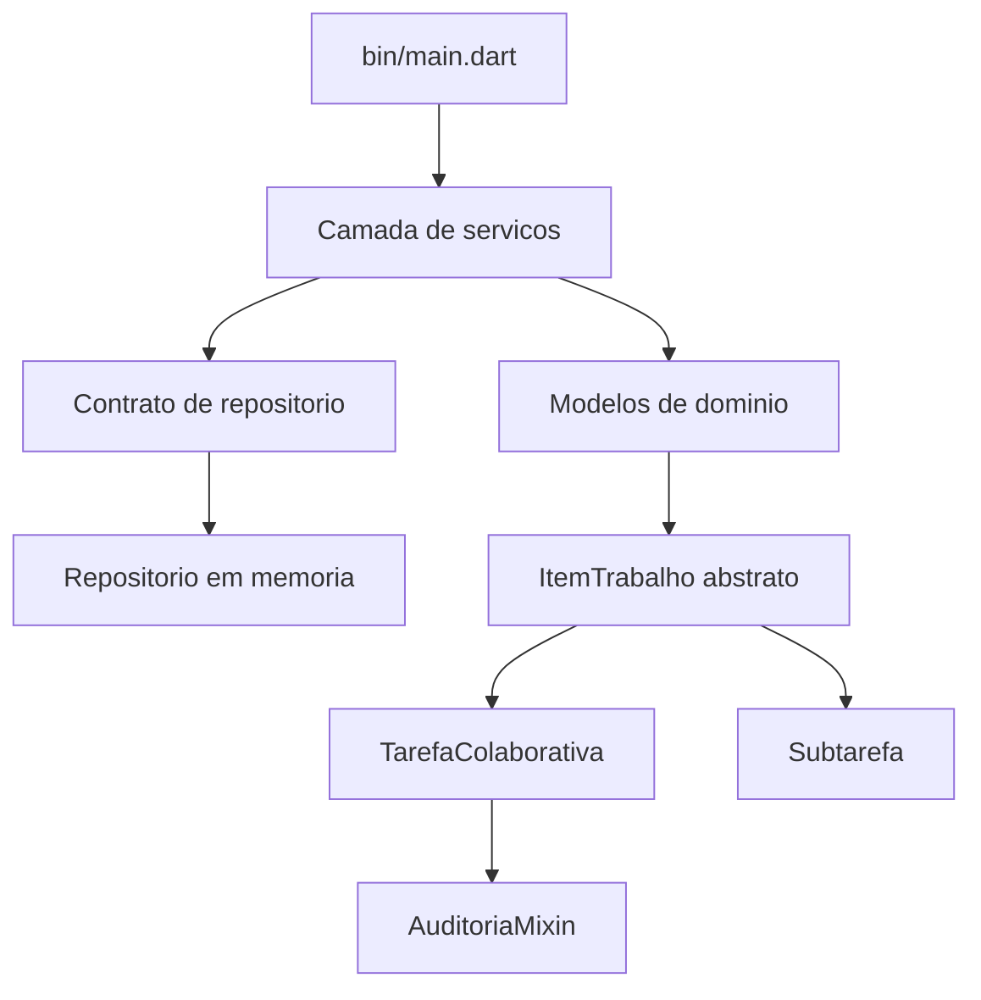

# TaskLink Core - Rede de Tarefas Colaborativas

Projeto do **Grupo 03 - Tema 07**, desenvolvido para a Avaliacao Processual do 1º bimestre da disciplina de Computacao Movel (Sistemas de Informacao - Multivix, 2026/2).

O projeto implementa, em Dart puro e sem acoplamento com a interface Flutter, o modulo central de dominio e logica de negocios de uma rede colaborativa. A solucao permite cadastrar membros, criar tarefas, compor subtarefas, delegar responsabilidades, acompanhar progresso, filtrar dados e simular a perda de conectividade de um dispositivo movel.

## Integrantes

- Andre Rezende Muruci de Mendonca
- Fabio Henrique dos Santos Buecker
- Juliano Jean Pierre
- Davi Checon Bresinski
- Raphael Picoli Zucolotto

## O que a demonstracao comprova

- Instanciacao por construtores gerativo, nomeado e `factory fromMap`.
- Classe abstrata, interface de repositorio, heranca com `extends` e sobrescritas com `@override`.
- Composicao de `TarefaColaborativa` com varias `Subtarefa`.
- Reuso transversal pelo `AuditoriaMixin`, aplicado com `with`.
- Encapsulamento por campos privados, getters e setters validados.
- Campos imutaveis com `final`.
- Sound Null Safety sem operador de assercao forçada `!`.
- Operadores `?`, `??`, `??=`, `?.`, `...` e `...?`.
- Colecoes `List`, `Map` e `Set`, alem de `.map()`, `.where()`, `.fold()`, `.every()` e `.any()`.
- Collection-If e Collection-For.
- Excecoes customizadas e fluxos `try-on-catch-finally` com `rethrow`.
- Simulacao de queda de conectividade, armazenamento em memoria e sincronizacao posterior.
- Relatorio formatado no terminal e testes automatizados.

## Arquitetura



```text
bin/
  main.dart                         Executavel de demonstracao
lib/
  core/                             Enums, mixin e excecoes
  models/                           Entidades e regras do dominio
  repositories/                     Contrato e implementacao em memoria
  services/                         Casos de uso, filtros, metricas e relatorio
test/                               Testes automatizados
docs/                               Mapeamento dos requisitos da atividade
scripts/                            Geracao do relatorio de ambiente
ENVIRONMENT_REPORT.md               Saida integral do flutter doctor -v
```

## Pre-requisitos

- Flutter SDK configurado e disponivel no `PATH`.
- Dart SDK incluido no Flutter.
- Git.
- Um emulador Android, dispositivo fisico ou ambiente reconhecido pelo `flutter doctor -v`.

## Preparar o ambiente

1. Clone o repositorio e entre na pasta:

   ```bash
   git clone https://github.com/Fabio-Buecker/rede-tarefas-colaborativas.git
   cd rede_tarefas_colaborativas
   ```

2. Instale as dependencias:

   ```bash
   dart pub get
   ```

3. Gere o relatorio real do ambiente no Windows:

   ```powershell
   powershell -ExecutionPolicy Bypass -File .\scripts\gerar_relatorio_ambiente.ps1
   ```

   Em Linux/macOS:

   ```bash
   ./scripts/gerar_relatorio_ambiente.sh
   ```

4. Confirme que `ENVIRONMENT_REPORT.md` contem a saida integral do `flutter doctor -v`.

## Executar o projeto

```bash
dart run bin/main.dart
```

A CLI cadastra membros, cria tarefas com os tres tipos de construtores, adiciona e delega subtarefas, conclui atividades, aplica filtros funcionais, trata uma delegacao invalida, simula uma conexao offline e apresenta o relatorio final.

## Qualidade e testes

Execute os comandos antes de cada entrega:

```bash
dart format --set-exit-if-changed .
dart analyze --fatal-infos
dart test
```

O workflow em `.github/workflows/dart.yml` repete essas verificacoes automaticamente em cada `push` e `pull request` para a branch `main`.

## Mapeamento dos requisitos

| Requisito | Evidencia principal |
|---|---|
| Setup e diagnostico | `ENVIRONMENT_REPORT.md`, `.gitignore`, scripts de ambiente e historico Git |
| Classe abstrata e contratos | `ItemTrabalho` e `TarefaRepository` |
| Heranca e polimorfismo | `Subtarefa extends ItemTrabalho` e `TarefaColaborativa extends ItemTrabalho` |
| Mixin | `AuditoriaMixin` usado por tarefa e gerenciador |
| Construtores | Gerativos, `Subtarefa.rapida`, `TarefaColaborativa.planejamento` e factories `fromMap` |
| Encapsulamento | Campos `_nome`, `_status`, `_progresso`, `_responsavelId` com getters/setters |
| Null safety | Tipos anulaveis controlados e nenhum uso de `!` |
| Colecoes funcionais | Servico usa `map`, `where`, `fold`, `every`, `any`, spreads e collections condicionais |
| Excecoes | Hierarquia em `lib/core/exceptions.dart`; tratamento e `rethrow` no gerenciador |
| CLI | `bin/main.dart` executa fluxos de sucesso e casos de borda |

O detalhamento completo esta em [`docs/MAPA_REQUISITOS.md`](docs/MAPA_REQUISITOS.md).

## Declaracao de Uso de IA

O ChatGPT foi utilizado como ferramenta de apoio para brainstorming da arquitetura, elaboracao de uma primeira versao do codigo e da documentacao, sugestao de testes e revisao de requisitos. A ferramenta nao participou da tomada de decisao avaliativa nem substitui o dominio tecnico dos estudantes. Antes da submissao, os integrantes devem revisar, executar, testar, adaptar e compreender integralmente cada parte do projeto. A responsabilidade pela versao entregue e pela defesa oral permanece com o grupo.

## Referencias

- MULTIVIX. **Computacao Movel - Avaliacao Processual 1B**. Material da disciplina, 25 ago. 2026.
- DART. **Constructors**. Disponivel em: <https://dart.dev/language/constructors>. Acesso em: 28 ago. 2026.
- DART. **Extend a class**. Disponivel em: <https://dart.dev/language/extend>. Acesso em: 28 ago. 2026.
- DART. **Mixins**. Disponivel em: <https://dart.dev/language/mixins>. Acesso em: 28 ago. 2026.
- DART. **Sound null safety**. Disponivel em: <https://dart.dev/null-safety>. Acesso em: 28 ago. 2026.
- DART. **Iterable collections**. Disponivel em: <https://dart.dev/libraries/collections/iterables>. Acesso em: 28 ago. 2026.

## Licenca academica

Projeto produzido para fins exclusivamente academicos na disciplina de Computacao Movel.

