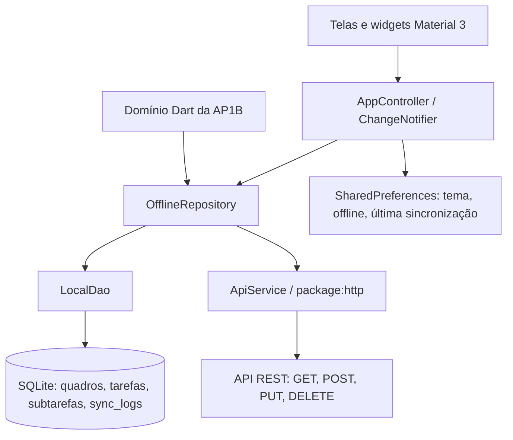

# TaskLink 2 - Rede de Tarefas Colaborativas

Aplicativo Flutter offline-first para a Avaliação Processual 2B de Computação Móvel, Multivix, 2026/2. **Grupo 03 - Tema 07. Professor: Edgard da Cunha Pontes.**

Evolução de [rede-tarefas-colaborativas (AP1B)](https://github.com/Fabio-Buecker/rede-tarefas-colaborativas), preservando histórico Git, entidades Dart, regras de progresso e testes anteriores. A documentação histórica está em [README_AP1B.md](README_AP1B.md). A versão original permanece no repositório anterior.

## Integrantes

- André Rezende Muruci de Mendonça
- Fábio Henrique dos Santos Buecker
- Juliano Jean Pierre
- Davi Checon Bresinski
- Raphael Picoli Zucolotto

## Funcionalidades

- Quadros com cadastro, consulta, edição e exclusão de quadros vazios.
- Tarefas com CRUD, participantes, prioridade, prazo, busca e filtros por estado.
- Subtarefas delegadas a participantes, conclusão de etapas e progresso agregado pelo domínio da AP1B.
- SQLite como fonte da interface, inclusive após fechar e reabrir o aplicativo.
- Escrita local imediata, badges pendente/sincronizado e fila de exclusões.
- Envio após escrita, retomada ao desativar o modo offline e sincronização manual.
- Importação explícita de modelos via GET, persistidos antes de aparecerem na interface.
- Material Design 3, tema claro/escuro, preferências e histórico de tentativas.
- Rotas nomeadas, argumentos tipados e proteção contra descarte acidental do formulário.

## Arquitetura offline-first



1. A UI recebe registros do SQLite por controller/repositório. Não há consultas SQL ou chamadas HTTP em `build()`.
2. Toda escrita salva uma revisão com `sincronizado = 0`; a UI é recarregada antes da tentativa HTTP.
3. A confirmação só marca a revisão enviada. Uma edição feita durante a requisição continua pendente. O ID remoto retornado é preservado para permitir edição/exclusão posterior.
4. A exclusão é lógica enquanto aguarda a API: desaparece da lista, mas continua em Pendências. Após DELETE confirmado, a tarefa e suas subtarefas são removidas por FK.
5. Falhas HTTP, socket, cliente, timeout e JSON inválido preservam o dado local e geram feedback/histórico. Erros de disco não viram sucesso.
6. O repositório impede sincronizações concorrentes. Não há polling: a própria requisição verifica se o serviço é alcançável.

`RegistroLocal` envolve `TarefaColaborativa` sem acoplar o domínio ao Flutter. `Quadro -> Tarefa -> Subtarefa` tem relacionamentos SQLite reais. A tabela de subtarefas e o snapshot JSON são atualizados na mesma transação, preservando o formato da AP1B. As leituras reconstroem esse snapshot; a tabela relacional também permite consultas e exclusões em cascata.

Quadros são organizações locais. As tarefas levam `quadroId` no payload. Não há colaboração em tempo real, autenticação ou merge de conflitos entre dispositivos: o escopo é CRUD local resiliente com sincronização REST.

## Estrutura

```text
lib/core/           enums, exceções e auditoria da AP1B
lib/models/         domínio original + RegistroLocal, Quadro e LogSync
lib/datasources/    LocalDao (sqflite) e ApiService (http)
lib/repositories/   OfflineRepository e repositórios históricos
lib/controllers/    estado reativo e preferências
lib/screens/        telas e formulários
lib/widgets/        shell, cartões e badges
lib/app.dart        roteamento e tema
lib/main.dart       inicialização das dependências
 test/              domínio, repositório, SQLite real e widgets
scripts/demo_api.py servidor REST didático persistente
 docs/              requisitos, defesa e validação
android/ ios/ windows/ projetos nativos gerados pelo Flutter
```

## Preparar e executar

Ambiente validado: **Flutter 3.47.9 / Dart 3.13.7**. Use Flutter estável compatível com `pubspec.lock`. Android/iOS usam `sqflite`; Windows usa `sqflite_common_ffi`.

```bash
git clone https://github.com/Fabio-Buecker/rede-tarefas-colaborativas-parte-2.git
cd rede-tarefas-colaborativas-parte-2
flutter pub get
flutter analyze
flutter test
flutter run
```

Selecione Android, iOS ou Windows. O projeto usa SQLite nativo e `dart:io`; **Web não é suportado**. iOS exige macOS/Xcode. Windows exige ferramentas C++ do Visual Studio e Modo de Desenvolvedor caso o Flutter solicite links simbólicos.

No Windows, prefira um caminho curto, como `C:\dev\tasklink`, com SDK fora do OneDrive. Foram observadas falhas das ferramentas com espaços/acentos; a validação usou aliases temporários para os mesmos arquivos.

## API pública padrão

Endpoint: **https://jsonplaceholder.typicode.com/todos**

- GET `/todos?_limit=10`: modelos de tarefas.
- POST `/todos`: criação simulada.
- PUT `/todos/{id}` e DELETE `/todos/{id}`: operações simuladas.
- Timeout de 8 segundos e verificação de status HTTP 2xx e JSON.

O JSONPlaceholder **não persiste gravações** e retorna IDs fictícios, normalmente 201. Um PUT posterior de um item recém-criado pode falhar porque o ID não existe no serviço. A tarefa continuará local e pendente. Para demonstrar o CRUD remoto completo, use o servidor didático abaixo. Não utilize dados pessoais na API pública.

## API REST didática com persistência real

Em outro terminal, com Python 3:

```bash
python scripts/demo_api.py
```

O servidor escuta `127.0.0.1:8080`, cria `scripts/demo_api.sqlite3` (ignorado no Git) e oferece `/todos` com GET/POST/PUT/DELETE reais. O POST é idempotente por `localId`. O app acessa esse processo por HTTP, separado de seu SQLite local.

Windows:

```bash
flutter run -d windows --dart-define=API_URL=http://127.0.0.1:8080/todos
```

Emulador Android:

```bash
flutter run --dart-define=API_URL=http://10.0.2.2:8080/todos
```

Para telefone físico na mesma rede, execute `python scripts/demo_api.py --host 0.0.0.0` e use o IP do computador na `API_URL`. HTTP sem TLS está habilitado somente no manifesto Android de **debug**, para o laboratório. Builds release usam HTTPS. iOS também requer API HTTPS ou configuração local de transporte para demonstração. O servidor didático não possui autenticação.

O GET importa modelos por ação explícita no primeiro quadro em ordem alfabética. Não substitui edições locais nem baixa automaticamente um estado remoto completo. Não há merge entre dispositivos.

## Rotas integradas

| Rota | Tela / argumento |
|---|---|
| `/` | Visão geral |
| `/quadros` | Lista de quadros |
| `/quadro/novo` | Cadastro de quadro |
| `/quadro/editar` | Edição, `IdArgs(quadroId)` |
| `/quadro` | Detalhes, `IdArgs(quadroId)` |
| `/tarefas` | Lista, busca e filtros |
| `/tarefa/nova` | Cadastro, `IdArgs(quadroId)` opcional |
| `/tarefa/editar` | Edição, `IdArgs(tarefaId)` |
| `/tarefa` | Detalhes, `IdArgs(tarefaId)` |
| `/subtarefa/nova` | Cadastro, `IdArgs(tarefaId)` |
| `/membros` | Equipe e responsabilidades |
| `/pendencias` | Fila de envio e exclusões |
| `/sincronizacao` | Diagnóstico, reenvio, GET e histórico |
| `/configuracoes` | Modo offline e tema |
| `/sobre` | Integrantes e declaração de IA |

Argumentos são verificados em `onGenerateRoute`. Rotas inválidas e entidades inexistentes geram telas informativas.

## Testes e demonstração

```bash
flutter test
flutter test test/offline_repository_test.dart
flutter test test/local_dao_test.dart
flutter test test/widget_test.dart
```

Os testes usam `flutter_test`, `group`, `test`, `expect`, `throwsA`, HTTP `MockClient` e fonte local fake. O DAO é testado com **SQLite real em memória**, FKs e transações. Os testes visuais usam `testWidgets`, `pumpWidget`, `pump`, `find`, `tap`, busca e validação de formulários. A suíte não depende da API pública online.

Para atualizar a referência visual intencionalmente: `flutter test --update-goldens test/responsive_test.dart`. O golden é comparado somente no Windows; a verificação de ausência de overflow também roda na CI Linux.

1. Inicie a API didática e o app com a `API_URL` correspondente.
2. Crie um quadro e uma tarefa com participantes; cadastre subtarefas e conclua uma etapa.
3. Ative Modo offline em Configurações e também modo avião no dispositivo (ou pare o servidor no Windows).
4. Crie, edite e exclua tarefas. As telas continuam operacionais e a fila indica pendências.
5. Feche e reabra o app para verificar a persistência.
6. Restaure a rede/servidor, desative o modo offline e pressione Sincronizar agora.
7. Confira badges, histórico e GET no servidor para comprovar a persistência remota.
8. Execute `flutter test` na defesa.

## Conteúdo das aulas aplicado

| Semana | Aplicação |
|---|---|
| 08 | StatelessWidget/StatefulWidget, layouts flexíveis, Scaffold e Material 3 |
| 09 | Dart, POO, composição, exceções e restrições móveis |
| 11 | Eventos, setState, initState/dispose, ChangeNotifier e mounted |
| 12 | onGenerateRoute, RouteSettings, argumentos tipados, Navigator e PopScope |
| 13 | SQLite, DAO, CRUD, transações e shared_preferences |
| 14 | Testes de domínio, repositório isolado e widgets |

Veja [requisitos](docs/REQUISITOS_AP2B.md), [defesa técnica](docs/DEFESA_TECNICA.md) e [validação](docs/VALIDACAO.md).

## Declaração de Uso de IA

Foi utilizada **OpenAI Codex/ChatGPT** para leitura dos requisitos dos PDFs, evolução do núcleo Dart para Flutter, geração de código, revisão da arquitetura offline-first, elaboração de testes e documentação e depuração do ambiente Windows. O agente executou a análise e os testes; resultados e limitações estão em `docs/VALIDACAO.md`.

Esta declaração não afirma uma revisão humana que ainda não ocorreu. Cada integrante deve executar, estudar e validar o projeto para explicar, depurar e modificar o código na defesa individual, conforme a política da avaliação.

## Entrega

O PDF determina entrega do link até **12/11/2026**, com assunto **[AP2B - Computação Móvel] - Tema 07 - Grupo 03**. O envio ao professor fica com a equipe; nenhum e-mail foi enviado automaticamente.

## Referências

- PONTES, Edgard da Cunha. Computação Móvel, Multivix: Semanas 08, 09, 11, 12, 13 e 14 e Avaliação Processual 2B, 2026/2. PDFs fornecidos pela equipe.
- [Flutter](https://docs.flutter.dev/), [SQLite](https://docs.flutter.dev/cookbook/persistence/sqlite) e [testes](https://docs.flutter.dev/testing/overview).
- [Dart async/await](https://dart.dev/libraries/async/async-await).
- [JSONPlaceholder: guia e operações simuladas](https://jsonplaceholder.typicode.com/guide/).
- [sqflite](https://pub.dev/packages/sqflite), [http](https://pub.dev/packages/http) e [shared_preferences](https://pub.dev/packages/shared_preferences).
